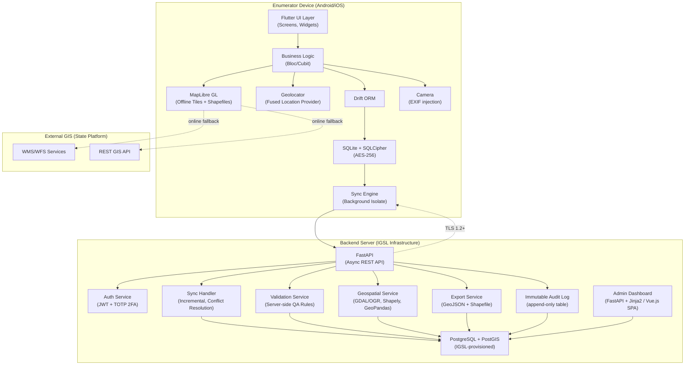
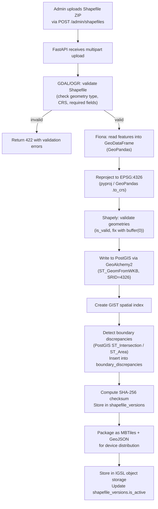
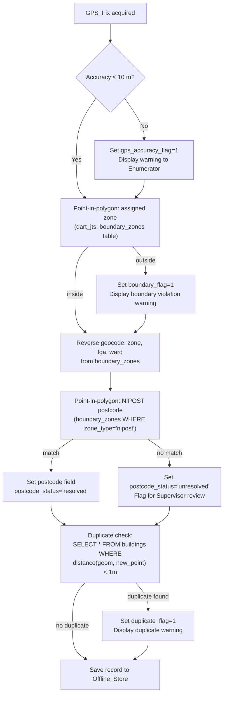
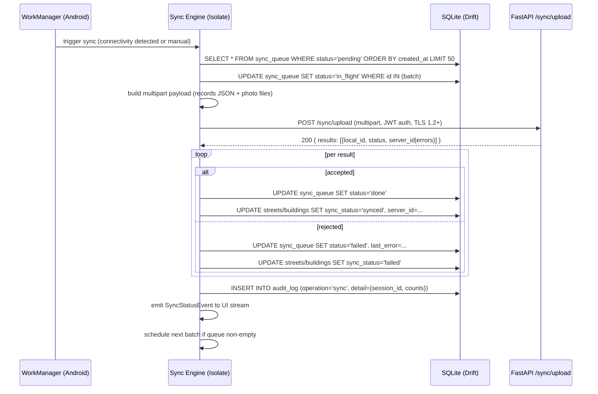

# FEVA — Field Enumeration and Verification App
# Technical Design Document

## Overview

FEVA is an offline-first mobile data collection system for systematic street and building enumeration across all LGAs in a Nigerian State. The system comprises a Flutter mobile app, a Python FastAPI backend, and a PostgreSQL/PostGIS server database. Data flows from field devices through an incremental sync engine to the central database, where it is validated, reviewed by supervisors, and exported as certified geospatial datasets.

### Design Goals

- Offline-first: full capture functionality with zero network dependency
- Spatial correctness: all geometry validated against government Shapefile boundaries
- Security: AES-256 at rest, TLS 1.2+ in transit, JWT RBAC, immutable audit log
- Performance: 100 records + photos synced in under 2 min on 3G; 200+ concurrent sessions
- Certified export: GeoJSON RFC 7946 and ESRI Shapefile with round-trip fidelity

### Phase Delivery Plan

| Phase | Scope | Exit Criteria |
|-------|-------|---------------|
| Phase 1 — MVP (Week 4) | Auth, street/building capture, offline store, GPS, photos, basic sync, Shapefile boundary layers, dropdown config | 100 records synced end-to-end; boundary containment working offline |
| Phase 2 — Enhanced | Supervisor spot-check, QA dashboard, duplicate detection, NIPOST postcode validation, live WMS/WFS, full QA rules, certified export | All QA rules passing; export round-trip verified; dashboard live |
| Phase 3 — Verification | QR code scan, verification mode, compliance report, dispute workflow | QR scan resolves Building_Record; compliance report generated per LGA |


---

## Architecture

### System Architecture Diagram



### Key Architectural Decisions

- **Flutter + Drift ORM**: Single codebase for Android/iOS; Drift provides type-safe SQLite access with migration support and reactive streams for UI updates.
- **SQLCipher**: Transparent AES-256 encryption of the entire SQLite database file; no application-level crypto complexity.
- **Background Isolate for Sync**: Sync runs in a Dart isolate so it never blocks the UI thread; uses WorkManager plugin for Android background scheduling.
- **FastAPI async**: Python async/await throughout; uvicorn + gunicorn workers handle 200+ concurrent sync sessions.
- **PostGIS**: Native spatial indexing (GIST) and spatial functions (ST_Within, ST_Distance) for server-side validation and export.
- **Geometry as WKB on device**: Well-Known Binary stored in SQLite BLOB columns; parsed by the `geopoint` / `latlong2` packages; avoids JSON overhead for spatial queries.
- **MapLibre GL**: Renders offline MBTiles + GeoJSON boundary layers; falls back to live WMS/WFS when online.


---

## Components and Interfaces

### Mobile Components

#### 1. Auth Module
- Screens: `LoginScreen`, `TwoFactorScreen`
- Bloc: `AuthBloc` — handles login, token storage (flutter_secure_storage), session expiry
- Interface: `POST /api/v1/auth/login` → `{access_token, refresh_token, role, user_id}`
- Stores session token in secure enclave; attaches as `Authorization: Bearer <token>` on all API calls

#### 2. Street Capture Module
- Screens: `StreetListScreen`, `StreetFormScreen`, `StreetMapScreen`
- Bloc: `StreetBloc`
- Generates `STR-[LGA]-[SEQ]` locally using last known sequence from SQLite
- Triggers GPS acquisition, photo capture, boundary containment check on save
- Interface: writes to `streets` table via Drift; enqueues to `sync_queue`

#### 3. Building Capture Module
- Screens: `BuildingListScreen`, `BuildingFormScreen`, `BuildingMapScreen`
- Bloc: `BuildingBloc`
- Generates `BLD-[LGA]-[SEQ]` locally
- Requires valid `street_id` foreign key; triggers duplicate detection (1 m radius)
- Interface: writes to `buildings` table via Drift; enqueues to `sync_queue`

#### 4. GPS Service
- Wraps `geolocator` package; exposes `Stream<Position>` with accuracy and satellite count
- Enforces 5 decimal place precision; raises `LowAccuracyWarning` when accuracy > 10 m
- Falls back to manual entry after 30 s timeout

#### 5. Photo Service
- Wraps `camera` package; injects GPS coordinates + UTC timestamp into EXIF via `native_exif`
- Stores files in app-private directory; records relative path in DB
- Validates file existence before sync; raises `BrokenPhotoReference` flag if missing

#### 6. Boundary Service (Offline Spatial)
- Loads Shapefile boundary layers from SQLite (stored as WKB polygons)
- Exposes `containmentCheck(Point, zone_id) → bool`
- Exposes `reverseGeocode(Point) → {zone, lga, ward, postcode}`
- Uses `dart_jts` (JTS port) for point-in-polygon; no network required

#### 7. Sync Engine
- Runs in Dart background isolate via `flutter_workmanager`
- Reads `sync_queue` table; batches records + photos; POSTs to `/api/v1/sync/upload`
- Handles partial failures: marks individual records synced/failed; retries on next cycle
- Emits `SyncStatusStream` consumed by UI to show unsynced count

#### 8. Map Component
- `MapLibreMapWidget` wrapping `flutter_maplibre_gl`
- Loads offline MBTiles from device storage
- Overlays GeoJSON boundary layers from SQLite
- Falls back to WMS/WFS tile source when online

#### 9. QR Scanner (Phase 3)
- Wraps `mobile_scanner` package
- Decodes QR → `building_id`; fetches `Building_Record` from local DB or API
- Presents verification confirmation/dispute UI

### Backend Components

#### 1. Auth Service (`/api/v1/auth/`)
- `POST /login` — validates credentials, issues JWT (python-jose), optionally validates TOTP
- `POST /refresh` — rotates access token using refresh token
- `POST /logout` — invalidates refresh token
- Account lockout after 3 failed attempts; Admin notification via audit log

#### 2. Sync Handler (`/api/v1/sync/`)
- `POST /upload` — receives batched records + photo multipart; runs server-side validation; writes to PostGIS; returns per-record success/error
- `GET /config` — returns latest dropdown config + Shapefile version checksums
- `GET /shapefiles/{layer}` — streams updated Shapefile package to device

#### 3. Records API (`/api/v1/records/`)
- `GET /streets`, `GET /buildings` — paginated, filterable by LGA/ward/status
- `GET /streets/{id}`, `GET /buildings/{id}` — single record with full geometry
- `PATCH /streets/{id}`, `PATCH /buildings/{id}` — supervisor approval/rejection

#### 4. Export Service (`/api/v1/export/`)
- `POST /export/geojson` — async job; returns `job_id`
- `POST /export/shapefile` — async job; returns `job_id`
- `GET /export/jobs/{job_id}` — poll status; returns download URL when complete
- `GET /export/monthly/{year}/{month}` — pre-generated monthly package

#### 5. Admin API (`/api/v1/admin/`)
- `GET/POST/PATCH/DELETE /users` — user management
- `GET/POST /dropdown-config` — manage dropdown values
- `GET /audit-log` — paginated read-only audit log

#### 6. QA Dashboard (`/dashboard/`)
- FastAPI + Jinja2 server-rendered pages (or Vue.js SPA served from `/dashboard/`)
- Polls `/api/v1/qa/metrics` every 5 minutes
- Displays submission counts, GPS accuracy, boundary containment %, duplicate flags


---

## Data Models

### SQLite Schema (Mobile Offline Store — Drift DDL)

```sql
-- Sessions table (active user session)
CREATE TABLE sessions (
    id              INTEGER PRIMARY KEY AUTOINCREMENT,
    user_id         TEXT    NOT NULL,
    username        TEXT    NOT NULL,
    role            TEXT    NOT NULL CHECK(role IN ('enumerator','supervisor','admin')),
    access_token    TEXT    NOT NULL,
    refresh_token   TEXT    NOT NULL,
    token_expires_at INTEGER NOT NULL,  -- Unix epoch ms
    created_at      INTEGER NOT NULL DEFAULT (strftime('%s','now') * 1000)
);

-- Dropdown configuration (sourced from backend, versioned)
CREATE TABLE dropdown_config (
    id          INTEGER PRIMARY KEY AUTOINCREMENT,
    category    TEXT    NOT NULL,  -- 'street_type','surface_type','street_condition','building_type','building_condition'
    value       TEXT    NOT NULL,
    label       TEXT    NOT NULL,
    sort_order  INTEGER NOT NULL DEFAULT 0,
    version     INTEGER NOT NULL DEFAULT 1,
    synced_at   INTEGER NOT NULL DEFAULT (strftime('%s','now') * 1000),
    UNIQUE(category, value)
);

-- Boundary zones (Shapefile polygons stored as WKB)
CREATE TABLE boundary_zones (
    id              INTEGER PRIMARY KEY AUTOINCREMENT,
    zone_id         TEXT    NOT NULL UNIQUE,
    zone_name       TEXT    NOT NULL,
    zone_type       TEXT    NOT NULL CHECK(zone_type IN ('lga','ward','nipost','admin')),
    lga_code        TEXT,
    ward_code       TEXT,
    postcode        TEXT,
    geometry_wkb    BLOB    NOT NULL,  -- WKB polygon, EPSG:4326
    shapefile_version TEXT  NOT NULL,
    created_at      INTEGER NOT NULL DEFAULT (strftime('%s','now') * 1000)
);
CREATE INDEX idx_boundary_zones_type ON boundary_zones(zone_type);

-- Streets
CREATE TABLE streets (
    id                  INTEGER PRIMARY KEY AUTOINCREMENT,
    street_id           TEXT    NOT NULL UNIQUE,  -- STR-[LGA]-[SEQ]
    street_name         TEXT    NOT NULL,
    street_type         TEXT    NOT NULL,
    surface_type        TEXT    NOT NULL,
    street_condition    TEXT    NOT NULL,
    notes               TEXT,
    geometry_wkb        BLOB    NOT NULL,  -- WKB LineString, EPSG:4326
    zone                TEXT,
    lga                 TEXT    NOT NULL,
    ward                TEXT,
    enumerator_id       TEXT    NOT NULL,
    enumeration_date    INTEGER NOT NULL,  -- Unix epoch ms
    verification_status TEXT    NOT NULL DEFAULT 'pending'
                            CHECK(verification_status IN ('pending','approved','rejected','verified','disputed')),
    boundary_flag       INTEGER NOT NULL DEFAULT 0,  -- 1 = outside assigned zone
    gps_accuracy_flag   INTEGER NOT NULL DEFAULT 0,  -- 1 = accuracy > 10m
    qa_flags            TEXT,   -- JSON array of rule names
    server_id           TEXT,   -- assigned by backend after sync
    sync_status         TEXT    NOT NULL DEFAULT 'queued'
                            CHECK(sync_status IN ('queued','synced','failed')),
    last_modified_at    INTEGER NOT NULL DEFAULT (strftime('%s','now') * 1000),
    created_at          INTEGER NOT NULL DEFAULT (strftime('%s','now') * 1000)
);
CREATE INDEX idx_streets_sync_status ON streets(sync_status);
CREATE INDEX idx_streets_lga ON streets(lga);

-- Buildings
CREATE TABLE buildings (
    id                  INTEGER PRIMARY KEY AUTOINCREMENT,
    building_id         TEXT    NOT NULL UNIQUE,  -- BLD-[LGA]-[SEQ]
    street_id           TEXT    NOT NULL REFERENCES streets(street_id),
    building_type       TEXT    NOT NULL,
    number_of_floors    INTEGER NOT NULL,
    number_of_units     INTEGER NOT NULL,
    building_condition  TEXT    NOT NULL,
    has_signage         INTEGER NOT NULL DEFAULT 0,  -- boolean
    business_names      TEXT,   -- JSON array, populated when has_signage=1
    notes               TEXT,
    geometry_wkb        BLOB    NOT NULL,  -- WKB Point, EPSG:4326
    gps_accuracy_m      REAL    NOT NULL,
    zone                TEXT,
    lga                 TEXT    NOT NULL,
    ward                TEXT,
    postcode            TEXT,
    postcode_status     TEXT    NOT NULL DEFAULT 'resolved'
                            CHECK(postcode_status IN ('resolved','unresolved')),
    enumerator_id       TEXT    NOT NULL,
    enumeration_date    INTEGER NOT NULL,
    verification_status TEXT    NOT NULL DEFAULT 'pending'
                            CHECK(verification_status IN ('pending','approved','rejected','verified','disputed')),
    rejection_reason    TEXT,
    dispute_reason      TEXT,
    verified_by         TEXT,
    verified_at         INTEGER,
    boundary_flag       INTEGER NOT NULL DEFAULT 0,
    gps_accuracy_flag   INTEGER NOT NULL DEFAULT 0,
    duplicate_flag      INTEGER NOT NULL DEFAULT 0,
    qa_flags            TEXT,   -- JSON array of rule names
    server_id           TEXT,
    sync_status         TEXT    NOT NULL DEFAULT 'queued'
                            CHECK(sync_status IN ('queued','synced','failed')),
    last_modified_at    INTEGER NOT NULL DEFAULT (strftime('%s','now') * 1000),
    created_at          INTEGER NOT NULL DEFAULT (strftime('%s','now') * 1000)
);
CREATE INDEX idx_buildings_sync_status ON buildings(sync_status);
CREATE INDEX idx_buildings_street_id ON buildings(street_id);
CREATE INDEX idx_buildings_lga ON buildings(lga);

-- Photos
CREATE TABLE photos (
    id              INTEGER PRIMARY KEY AUTOINCREMENT,
    photo_id        TEXT    NOT NULL UNIQUE,
    record_type     TEXT    NOT NULL CHECK(record_type IN ('street','building')),
    record_local_id INTEGER NOT NULL,  -- FK to streets.id or buildings.id
    file_path       TEXT    NOT NULL,  -- relative path within app storage
    is_frontage     INTEGER NOT NULL DEFAULT 0,
    latitude        REAL    NOT NULL,
    longitude       REAL    NOT NULL,
    captured_at     INTEGER NOT NULL,  -- Unix epoch ms (from EXIF)
    file_size_bytes INTEGER,
    broken_ref_flag INTEGER NOT NULL DEFAULT 0,
    sync_status     TEXT    NOT NULL DEFAULT 'queued'
                        CHECK(sync_status IN ('queued','synced','failed')),
    created_at      INTEGER NOT NULL DEFAULT (strftime('%s','now') * 1000)
);
CREATE INDEX idx_photos_record ON photos(record_type, record_local_id);
CREATE INDEX idx_photos_sync_status ON photos(sync_status);

-- Sync queue (pending upload operations)
CREATE TABLE sync_queue (
    id              INTEGER PRIMARY KEY AUTOINCREMENT,
    operation       TEXT    NOT NULL CHECK(operation IN ('create','update','delete')),
    entity_type     TEXT    NOT NULL CHECK(entity_type IN ('street','building','photo')),
    entity_local_id INTEGER NOT NULL,
    payload_json    TEXT    NOT NULL,  -- serialised record snapshot at queue time
    attempt_count   INTEGER NOT NULL DEFAULT 0,
    last_attempt_at INTEGER,
    last_error      TEXT,
    status          TEXT    NOT NULL DEFAULT 'pending'
                        CHECK(status IN ('pending','in_flight','done','failed')),
    created_at      INTEGER NOT NULL DEFAULT (strftime('%s','now') * 1000)
);
CREATE INDEX idx_sync_queue_status ON sync_queue(status);

-- Audit log (device-side, append-only mirror)
CREATE TABLE audit_log (
    id              INTEGER PRIMARY KEY AUTOINCREMENT,
    user_id         TEXT    NOT NULL,
    operation       TEXT    NOT NULL,  -- 'login','logout','create','update','delete','sync','flag'
    entity_type     TEXT,
    entity_id       TEXT,
    detail_json     TEXT,   -- additional context as JSON
    occurred_at     INTEGER NOT NULL DEFAULT (strftime('%s','now') * 1000)
    -- No UPDATE or DELETE triggers allowed on this table
);
```


### PostgreSQL/PostGIS Schema (Backend)

```sql
-- Enable PostGIS
CREATE EXTENSION IF NOT EXISTS postgis;
CREATE EXTENSION IF NOT EXISTS pgcrypto;

-- ── RBAC ──────────────────────────────────────────────────────────────────────

CREATE TABLE roles (
    id          SERIAL PRIMARY KEY,
    name        TEXT NOT NULL UNIQUE  -- 'enumerator','supervisor','admin'
);

CREATE TABLE users (
    id              UUID PRIMARY KEY DEFAULT gen_random_uuid(),
    username        TEXT NOT NULL UNIQUE,
    email           TEXT NOT NULL UNIQUE,
    password_hash   TEXT NOT NULL,
    role_id         INTEGER NOT NULL REFERENCES roles(id),
    lga_assignment  TEXT[],           -- LGAs this user is assigned to
    totp_secret     TEXT,             -- NULL = 2FA not enabled
    totp_enabled    BOOLEAN NOT NULL DEFAULT FALSE,
    failed_attempts INTEGER NOT NULL DEFAULT 0,
    locked_at       TIMESTAMPTZ,
    created_at      TIMESTAMPTZ NOT NULL DEFAULT NOW(),
    updated_at      TIMESTAMPTZ NOT NULL DEFAULT NOW()
);
CREATE INDEX idx_users_role ON users(role_id);

-- ── DROPDOWN CONFIG ───────────────────────────────────────────────────────────

CREATE TABLE dropdown_config (
    id          SERIAL PRIMARY KEY,
    category    TEXT NOT NULL,
    value       TEXT NOT NULL,
    label       TEXT NOT NULL,
    sort_order  INTEGER NOT NULL DEFAULT 0,
    version     INTEGER NOT NULL DEFAULT 1,
    created_by  UUID REFERENCES users(id),
    created_at  TIMESTAMPTZ NOT NULL DEFAULT NOW(),
    UNIQUE(category, value)
);

-- ── SHAPEFILE VERSIONS ────────────────────────────────────────────────────────

CREATE TABLE shapefile_versions (
    id              SERIAL PRIMARY KEY,
    layer_name      TEXT NOT NULL,
    version_tag     TEXT NOT NULL,
    checksum_sha256 TEXT NOT NULL,
    uploaded_by     UUID REFERENCES users(id),
    uploaded_at     TIMESTAMPTZ NOT NULL DEFAULT NOW(),
    is_active       BOOLEAN NOT NULL DEFAULT TRUE
);

-- ── STREETS ───────────────────────────────────────────────────────────────────

CREATE TABLE streets (
    id                  UUID PRIMARY KEY DEFAULT gen_random_uuid(),
    street_id           TEXT NOT NULL UNIQUE,   -- STR-[LGA]-[SEQ]
    street_name         TEXT NOT NULL,
    street_type         TEXT NOT NULL,
    surface_type        TEXT NOT NULL,
    street_condition    TEXT NOT NULL,
    notes               TEXT,
    geom                GEOMETRY(LineString, 4326) NOT NULL,
    zone                TEXT,
    lga                 TEXT NOT NULL,
    ward                TEXT,
    enumerator_id       UUID NOT NULL REFERENCES users(id),
    enumeration_date    TIMESTAMPTZ NOT NULL,
    verification_status TEXT NOT NULL DEFAULT 'pending'
                            CHECK(verification_status IN ('pending','approved','rejected','verified','disputed')),
    reviewed_by         UUID REFERENCES users(id),
    reviewed_at         TIMESTAMPTZ,
    rejection_reason    TEXT,
    boundary_flag       BOOLEAN NOT NULL DEFAULT FALSE,
    gps_accuracy_flag   BOOLEAN NOT NULL DEFAULT FALSE,
    qa_flags            JSONB,
    device_local_id     INTEGER,   -- original SQLite id for dedup
    device_id           TEXT,      -- device fingerprint
    synced_at           TIMESTAMPTZ NOT NULL DEFAULT NOW(),
    created_at          TIMESTAMPTZ NOT NULL DEFAULT NOW(),
    updated_at          TIMESTAMPTZ NOT NULL DEFAULT NOW()
);
CREATE INDEX idx_streets_geom ON streets USING GIST(geom);
CREATE INDEX idx_streets_lga ON streets(lga);
CREATE INDEX idx_streets_status ON streets(verification_status);
CREATE INDEX idx_streets_enumerator ON streets(enumerator_id);

-- ── BUILDINGS ─────────────────────────────────────────────────────────────────

CREATE TABLE buildings (
    id                  UUID PRIMARY KEY DEFAULT gen_random_uuid(),
    building_id         TEXT NOT NULL UNIQUE,   -- BLD-[LGA]-[SEQ]
    street_id           TEXT NOT NULL REFERENCES streets(street_id),
    building_type       TEXT NOT NULL,
    number_of_floors    INTEGER NOT NULL,
    number_of_units     INTEGER NOT NULL,
    building_condition  TEXT NOT NULL,
    has_signage         BOOLEAN NOT NULL DEFAULT FALSE,
    business_names      TEXT[],
    notes               TEXT,
    geom                GEOMETRY(Point, 4326) NOT NULL,
    gps_accuracy_m      NUMERIC(8,3) NOT NULL,
    zone                TEXT,
    lga                 TEXT NOT NULL,
    ward                TEXT,
    postcode            TEXT,
    postcode_status     TEXT NOT NULL DEFAULT 'resolved'
                            CHECK(postcode_status IN ('resolved','unresolved')),
    enumerator_id       UUID NOT NULL REFERENCES users(id),
    enumeration_date    TIMESTAMPTZ NOT NULL,
    verification_status TEXT NOT NULL DEFAULT 'pending'
                            CHECK(verification_status IN ('pending','approved','rejected','verified','disputed')),
    reviewed_by         UUID REFERENCES users(id),
    reviewed_at         TIMESTAMPTZ,
    rejection_reason    TEXT,
    dispute_reason      TEXT,
    verified_by         UUID REFERENCES users(id),
    verified_at         TIMESTAMPTZ,
    boundary_flag       BOOLEAN NOT NULL DEFAULT FALSE,
    gps_accuracy_flag   BOOLEAN NOT NULL DEFAULT FALSE,
    duplicate_flag      BOOLEAN NOT NULL DEFAULT FALSE,
    qa_flags            JSONB,
    qr_code_value       TEXT UNIQUE,   -- generated after Phase 1 sync
    device_local_id     INTEGER,
    device_id           TEXT,
    synced_at           TIMESTAMPTZ NOT NULL DEFAULT NOW(),
    created_at          TIMESTAMPTZ NOT NULL DEFAULT NOW(),
    updated_at          TIMESTAMPTZ NOT NULL DEFAULT NOW()
);
CREATE INDEX idx_buildings_geom ON buildings USING GIST(geom);
CREATE INDEX idx_buildings_lga ON buildings(lga);
CREATE INDEX idx_buildings_street ON buildings(street_id);
CREATE INDEX idx_buildings_status ON buildings(verification_status);
CREATE INDEX idx_buildings_enumerator ON buildings(enumerator_id);
-- Spatial index for duplicate detection (1 m radius queries)
CREATE INDEX idx_buildings_geom_dup ON buildings USING GIST(geom);

-- ── PHOTOS ────────────────────────────────────────────────────────────────────

CREATE TABLE photos (
    id              UUID PRIMARY KEY DEFAULT gen_random_uuid(),
    photo_id        TEXT NOT NULL UNIQUE,
    record_type     TEXT NOT NULL CHECK(record_type IN ('street','building')),
    record_id       UUID NOT NULL,   -- FK to streets.id or buildings.id
    storage_path    TEXT NOT NULL,   -- object storage path
    is_frontage     BOOLEAN NOT NULL DEFAULT FALSE,
    geom            GEOMETRY(Point, 4326),
    captured_at     TIMESTAMPTZ NOT NULL,
    file_size_bytes INTEGER,
    synced_at       TIMESTAMPTZ NOT NULL DEFAULT NOW()
);
CREATE INDEX idx_photos_record ON photos(record_type, record_id);

-- ── AUDIT LOG (IMMUTABLE) ─────────────────────────────────────────────────────

CREATE TABLE audit_log (
    id          BIGSERIAL PRIMARY KEY,
    user_id     UUID REFERENCES users(id),
    operation   TEXT NOT NULL,
    entity_type TEXT,
    entity_id   TEXT,
    detail      JSONB,
    ip_address  INET,
    occurred_at TIMESTAMPTZ NOT NULL DEFAULT NOW()
);
-- Immutability enforced via trigger: no UPDATE or DELETE allowed
CREATE OR REPLACE FUNCTION audit_log_immutable() RETURNS TRIGGER AS $$
BEGIN
    RAISE EXCEPTION 'audit_log is immutable: updates and deletes are not permitted';
END;
$$ LANGUAGE plpgsql;

CREATE TRIGGER trg_audit_log_no_update
    BEFORE UPDATE ON audit_log FOR EACH ROW EXECUTE FUNCTION audit_log_immutable();
CREATE TRIGGER trg_audit_log_no_delete
    BEFORE DELETE ON audit_log FOR EACH ROW EXECUTE FUNCTION audit_log_immutable();

-- Partition by month for retention management (24-month minimum)
-- Partitioning DDL omitted for brevity; use pg_partman in production.

-- ── BOUNDARY DISCREPANCIES ──────────────────────────────────────────────────

CREATE TABLE boundary_discrepancies (
    id                  BIGSERIAL PRIMARY KEY,
    postcode_polygon_id TEXT NOT NULL,          -- NIPOST postcode identifier
    admin_polygon_id    TEXT NOT NULL,          -- LGA or Ward polygon identifier
    admin_type          TEXT NOT NULL CHECK(admin_type IN ('lga','ward')),
    overlap_area_m2     NUMERIC(18,4) NOT NULL, -- ST_Area(ST_Intersection(...), use_spheroid:=true)
    shapefile_version_id INTEGER REFERENCES shapefile_versions(id),
    detected_at         TIMESTAMPTZ NOT NULL DEFAULT NOW()
);
CREATE INDEX idx_boundary_discrepancies_postcode ON boundary_discrepancies(postcode_polygon_id);
CREATE INDEX idx_boundary_discrepancies_admin ON boundary_discrepancies(admin_polygon_id, admin_type);
CREATE INDEX idx_boundary_discrepancies_detected ON boundary_discrepancies(detected_at);

-- ── SYNC SESSIONS ─────────────────────────────────────────────────────────────

CREATE TABLE sync_sessions (
    id              UUID PRIMARY KEY DEFAULT gen_random_uuid(),
    user_id         UUID NOT NULL REFERENCES users(id),
    device_id       TEXT NOT NULL,
    started_at      TIMESTAMPTZ NOT NULL DEFAULT NOW(),
    completed_at    TIMESTAMPTZ,
    records_received INTEGER NOT NULL DEFAULT 0,
    records_accepted INTEGER NOT NULL DEFAULT 0,
    records_rejected INTEGER NOT NULL DEFAULT 0,
    status          TEXT NOT NULL DEFAULT 'in_progress'
                        CHECK(status IN ('in_progress','completed','failed'))
);
```


---

## FastAPI REST API Design

All endpoints are prefixed `/api/v1/`. All requests require `Authorization: Bearer <JWT>` except `/auth/login`.

### Authentication Endpoints

| Method | Path | Description | Roles |
|--------|------|-------------|-------|
| POST | `/auth/login` | Credential + optional TOTP validation; returns JWT pair | Public |
| POST | `/auth/refresh` | Rotate access token | Any |
| POST | `/auth/logout` | Invalidate refresh token | Any |
| POST | `/auth/totp/setup` | Generate TOTP secret for user | Admin |
| POST | `/auth/totp/verify` | Verify TOTP code during login | Any |

**Login request/response:**
```json
// POST /auth/login
{ "username": "string", "password": "string", "totp_code": "string|null" }

// 200 OK
{ "access_token": "...", "refresh_token": "...", "token_type": "bearer",
  "expires_in": 28800, "role": "enumerator", "user_id": "uuid" }

// 401 — invalid credentials
// 403 — account locked
// 422 — TOTP required but not provided
```

### Sync Endpoints

| Method | Path | Description | Roles |
|--------|------|-------------|-------|
| POST | `/sync/upload` | Batch upload streets, buildings, photos | Enumerator, Supervisor |
| GET | `/sync/config` | Dropdown config + Shapefile checksums | Any |
| GET | `/sync/shapefiles/{layer}` | Download Shapefile package | Any |
| GET | `/sync/status` | Last sync timestamp for device | Any |

**Upload request (multipart/form-data):**
```
records_json: JSON array of street/building records
photos[]: binary photo files keyed by photo_id
device_id: string
last_sync_at: ISO8601 timestamp
```

**Upload response:**
```json
{
  "session_id": "uuid",
  "results": [
    { "local_id": 42, "entity_type": "building", "status": "accepted", "server_id": "uuid" },
    { "local_id": 43, "entity_type": "building", "status": "rejected",
      "errors": [{"field": "street_id", "code": "INVALID_REF", "message": "Street STR-ABJ-00001 not found"}] }
  ]
}
```

### Records Endpoints

| Method | Path | Description | Roles |
|--------|------|-------------|-------|
| GET | `/records/streets` | Paginated list; filter by lga, ward, status | Supervisor, Admin |
| GET | `/records/streets/{id}` | Single street with geometry | Supervisor, Admin |
| PATCH | `/records/streets/{id}` | Update verification_status | Supervisor, Admin |
| GET | `/records/buildings` | Paginated list; filter by lga, ward, status, flags | Supervisor, Admin |
| GET | `/records/buildings/{id}` | Single building with geometry | Supervisor, Admin |
| PATCH | `/records/buildings/{id}` | Update verification_status, rejection_reason | Supervisor, Admin |
| GET | `/records/buildings/{id}/qr` | Generate/retrieve QR code PNG | Supervisor, Admin |

### Admin Endpoints

| Method | Path | Description | Roles |
|--------|------|-------------|-------|
| GET | `/admin/users` | List users | Admin |
| POST | `/admin/users` | Create user | Admin |
| PATCH | `/admin/users/{id}` | Update user (role, assignment, lock) | Admin |
| DELETE | `/admin/users/{id}` | Deactivate user | Admin |
| GET | `/admin/dropdown-config` | List all dropdown values | Admin |
| POST | `/admin/dropdown-config` | Add/update dropdown values | Admin |
| POST | `/admin/shapefiles` | Upload new Shapefile version | Admin |
| GET | `/admin/audit-log` | Paginated audit log (read-only) | Admin |

### Export Endpoints

| Method | Path | Description | Roles |
|--------|------|-------------|-------|
| POST | `/export/geojson` | Async GeoJSON export job | Admin |
| POST | `/export/shapefile` | Async Shapefile export job | Admin |
| GET | `/export/jobs/{job_id}` | Poll export job status | Admin |
| GET | `/export/download/{job_id}` | Download completed export | Admin |
| GET | `/export/monthly/{year}/{month}` | Pre-generated monthly package (GeoJSON + Shapefile + coverage report + DQ metrics snapshot) | Admin |
| GET | `/export/monthly/{year}/{month}/coverage-report` | Coverage report for month (CSV or JSON) | Admin |
| GET | `/export/monthly/{year}/{month}/dq-metrics` | DQ metrics snapshot for month (CSV or JSON) | Admin |
| GET | `/export/boundary-discrepancies` | On-demand boundary discrepancy report (JSON or CSV) | Admin |

**Export request body:**
```json
{
  "record_type": "buildings|streets|both",
  "lga_filter": ["LGA1", "LGA2"],
  "status_filter": "approved",
  "date_from": "2024-01-01",
  "date_to": "2024-12-31",
  "format": "geojson|shapefile"
}
```

### QA Endpoints

| Method | Path | Description | Roles |
|--------|------|-------------|-------|
| GET | `/qa/metrics` | Aggregated quality metrics | Supervisor, Admin |
| GET | `/qa/flags` | Records with active QA flags | Supervisor, Admin |
| GET | `/qa/duplicates` | All duplicate-flagged building pairs | Supervisor, Admin |
| GET | `/qa/submission-counts` | Daily/weekly counts by enumerator/LGA/ward | Supervisor, Admin |
| GET | `/qa/boundary-discrepancies` | All boundary discrepancy records; filter by `lga`, `admin_type` | Supervisor, Admin |


---

## Geospatial Integration Design

### Shapefile Ingestion Pipeline



### Boundary Discrepancy Detection Algorithm

After writing all Shapefile layers to PostGIS, the ingestion pipeline runs a cross-layer intersection query for every NIPOST postcode polygon against every LGA and Ward polygon:

```sql
-- Run once per ingestion job; results inserted into boundary_discrepancies
INSERT INTO boundary_discrepancies
    (postcode_polygon_id, admin_polygon_id, admin_type, overlap_area_m2, shapefile_version_id)
SELECT
    n.postcode_id,
    a.admin_id,
    a.admin_type,
    ST_Area(ST_Intersection(n.geom, a.geom)::geography, true) AS overlap_area_m2,
    :shapefile_version_id
FROM nipost_polygons n
JOIN admin_polygons a
  ON ST_Intersects(n.geom, a.geom)
 AND NOT ST_Touches(n.geom, a.geom)   -- exclude boundary-only contact
WHERE ST_Area(ST_Intersection(n.geom, a.geom)::geography, true) > 0;
```

- `ST_Intersects` uses the GIST index for fast candidate filtering.
- `ST_Touches` exclusion ensures shared edges (valid topology) are not flagged.
- `ST_Area(...::geography, true)` returns area in square metres using the spheroid.
- NIPOST polygons with zero intersecting admin polygons produce no rows (zero-discrepancy case; no false positive).
- The ingestion task is idempotent: re-uploading the same Shapefile version (same checksum) skips re-detection.

### Device Boundary Layer Packaging

1. Backend generates a GeoJSON FeatureCollection per layer (LGA, Ward, NIPOST) from PostGIS
2. Polygons are simplified (Douglas-Peucker, tolerance 0.0001°) for device storage efficiency
3. Packaged as a single `.feva_boundaries` ZIP containing per-layer GeoJSON files
4. SHA-256 checksum stored in `shapefile_versions`; device compares on each sync
5. Device stores polygon WKB in `boundary_zones` SQLite table; `dart_jts` handles point-in-polygon

### Spatial Validation Flowchart (Device)



### Live WMS/WFS Fallback

- `MapLibreMapWidget` is configured with two tile sources: offline MBTiles (primary) and WMS/WFS URL (secondary)
- `ConnectivityService` monitors network state; switches tile source on change
- WFS `GetFeature` requests are used for live boundary overlay when online
- All WMS/WFS requests include the JWT in the `Authorization` header where the State GIS platform supports it
- If WMS/WFS returns an error, the map silently falls back to offline tiles; no capture interruption


---

## Sync Engine Design

### Incremental Sync Algorithm



### Conflict Resolution

FEVA uses a **last-write-wins with server authority** strategy:

- Device is the source of truth for new records (creates)
- Server is the source of truth for `verification_status` changes (approvals/rejections)
- On upload, server checks `device_local_id + device_id` for deduplication; duplicate uploads are idempotent (return existing `server_id`)
- If a record was rejected by the server (validation failure), it stays in `sync_queue` with `status='failed'`; the Enumerator is notified with the specific error
- No two-way sync of record content (device never overwrites server-approved records)

### Concurrency Design

- FastAPI runs with `uvicorn` + `gunicorn` (4–8 async workers per server node)
- Each `POST /sync/upload` is handled in a single async request; photo writes are streamed to object storage concurrently using `asyncio.gather`
- PostgreSQL connection pool: `asyncpg` with pool size 20 per worker; 200 concurrent sessions → ~25 DB connections per worker (well within PostGIS limits)
- Sync batches are capped at 50 records per request to bound memory and latency; a 100-record sync completes in 2 batches

### Performance Targets

| Metric | Target | Design Mechanism |
|--------|--------|-----------------|
| 100 records + photos on 3G | < 2 min | 50-record batches; async photo streaming; compressed JSON |
| 200 concurrent sessions | No degradation | Async FastAPI workers; asyncpg connection pool |
| GPS fix acquisition | < 30 s | Fused Location Provider; warm cache from last fix |
| Offline store capacity | 5,000+ buildings | SQLite WAL mode; BLOB photo paths (not inline) |
| Battery life | 8 h continuous | Background isolate sleeps between sync cycles; GPS duty-cycling |


---

## Security Design

### Transport Security
- All API communication over TLS 1.2+ (TLS 1.3 preferred); enforced at the load balancer
- Certificate pinning in the Flutter app using `http_certificate_pinning` package
- No plaintext fallback; HTTP requests are rejected with 301 redirect to HTTPS

### At-Rest Encryption
- SQLCipher provides transparent AES-256-CBC encryption of the entire SQLite database file
- Encryption key derived from user password + device-specific salt using PBKDF2 (100,000 iterations)
- Key stored in Android Keystore / iOS Secure Enclave via `flutter_secure_storage`
- Photos stored in app-private directory (not accessible to other apps on Android)

### JWT Authentication
- Access tokens: RS256, 8-hour expiry (field session duration)
- Refresh tokens: opaque, stored in `users.refresh_token_hash` (hashed), 30-day expiry
- Token payload: `{ sub: user_id, role: "enumerator", lga: [...], iat, exp }`
- RBAC middleware in FastAPI checks `role` claim against endpoint permission table
- Token revocation: refresh token hash deleted on logout; access tokens expire naturally

### 2FA (TOTP)
- RFC 6238 TOTP; 30-second window; 6-digit code
- Secret generated server-side using `pyotp`; delivered to user as QR code via Admin setup flow
- TOTP verification required at login when `users.totp_enabled = TRUE`
- Backup codes (8 single-use codes) generated at TOTP setup; stored as bcrypt hashes

### Account Lockout
- 3 consecutive failed login attempts → account locked (`users.locked_at` set)
- Locked accounts return 403; Admin must unlock via `PATCH /admin/users/{id}`
- All failed attempts written to `audit_log`

### Audit Log Immutability
- PostgreSQL triggers (`trg_audit_log_no_update`, `trg_audit_log_no_delete`) prevent any modification
- `audit_log` table owned by a dedicated DB role with INSERT-only grants; application user cannot ALTER or DROP
- 24-month retention enforced via monthly partitioning + partition drop policy (Admin-only, requires explicit confirmation)
- Device-side `audit_log` table has no UPDATE/DELETE triggers in Drift schema; enforced at ORM layer

### RBAC Permission Matrix

| Endpoint Group | Enumerator | Supervisor | Admin |
|----------------|-----------|-----------|-------|
| Street/Building capture (own records) | ✓ | ✓ | ✓ |
| View own submission history | ✓ | ✓ | ✓ |
| Spot-check review (approve/reject) | ✗ | ✓ | ✓ |
| QA Dashboard | ✗ | ✓ | ✓ |
| User management | ✗ | ✗ | ✓ |
| Dropdown config | ✗ | ✗ | ✓ |
| Shapefile upload | ✗ | ✗ | ✓ |
| Data export | ✗ | ✗ | ✓ |
| Audit log read | ✗ | ✗ | ✓ |


---

## Data Export Pipeline

### GeoJSON Export (RFC 7946)

```python
# Pseudocode — FastAPI background task
async def export_geojson(job: ExportJob, db: AsyncSession):
    query = select(Building).where(
        Building.verification_status == "approved",
        Building.lga.in_(job.lga_filter)
    )
    gdf = gpd.GeoDataFrame.from_postgis(query, db.bind, geom_col="geom", crs="EPSG:4326")
    
    # Ensure RFC 7946: longitude first, EPSG:4326, no CRS member in output
    gdf = gdf.to_crs("EPSG:4326")
    
    # Map columns to RFP Appendix A field names
    gdf = gdf.rename(columns=FIELD_NAME_MAP)
    
    # Write via Fiona (ensures RFC 7946 compliance)
    output_path = f"/exports/{job.id}.geojson"
    gdf.to_file(output_path, driver="GeoJSON")
    
    # Verify round-trip
    gdf_rt = gpd.read_file(output_path)
    assert_geojson_roundtrip(gdf, gdf_rt)  # raises if coordinates differ > 1e-5
    
    return output_path
```

### Shapefile Export (GDAL/OGR)

```python
async def export_shapefile(job: ExportJob, db: AsyncSession):
    gdf = load_approved_records(job, db)
    
    # Reproject if needed (Shapefile supports EPSG:4326)
    gdf = gdf.to_crs("EPSG:4326")
    
    # Write via GDAL/OGR through GeoPandas
    output_dir = f"/exports/{job.id}_shp/"
    gdf.to_file(output_dir, driver="ESRI Shapefile")
    
    # Zip the .shp, .shx, .dbf, .prj files
    zip_path = shutil.make_archive(f"/exports/{job.id}", "zip", output_dir)
    return zip_path
```

### Round-Trip Guarantee

The export pipeline enforces the round-trip property (Requirement 14.6, 14.7, 15.4):

1. After writing GeoJSON, the pipeline re-reads it with `fiona.open()` and compares:
   - All attribute fields present and equal
   - Geometry coordinates equal to 5 decimal places (tolerance 1e-5°)
2. If the round-trip check fails, the export job is marked `failed` and the Admin is notified
3. Shapefile round-trip is validated by re-importing the ZIP and comparing geometry WKT

### Certified Export Filter

- Only records with `verification_status = 'approved'` are included in certified exports
- Export metadata includes: export timestamp, Admin user_id, record count, LGA filter, date range
- Export job written to `audit_log` with full parameters

### Monthly Automated Export

- Celery beat task runs on the 1st of each month at 02:00 UTC
- Generates GeoJSON + Shapefile for all approved records in the previous month
- Stored in IGSL object storage; download link emailed to Admin users

**Monthly package structure** (ZIP):
```
feva_export_{year}_{month}/
├── streets.geojson
├── streets.zip              # ESRI Shapefile
├── buildings.geojson
├── buildings.zip            # ESRI Shapefile
├── coverage_report.csv      # street/building counts per LGA and per Enumerator
├── dq_metrics_snapshot.csv  # 5 QA metrics (Req 13.2) computed for the month
└── boundary_discrepancies.csv  # included in certified export packages (Req 21.5)
```

**Coverage report columns**: `lga`, `enumerator_id`, `enumerator_username`, `street_count`, `building_count`, `month`.
Zero-count rows are included for any LGA or Enumerator with no records in the month (Req 22.6).

**DQ metrics snapshot columns**: `month`, `median_gps_accuracy_m`, `boundary_containment_pct`, `mandatory_field_completion_pct`, `valid_photo_reference_pct`, `approved_verification_pct`.
All metrics are computed over records with `enumeration_date` within the calendar month.

The on-demand endpoints (`/coverage-report`, `/dq-metrics`) accept optional `?format=csv|json` query parameter (default: `json`).
The certified export endpoint applies the same `lga_filter`, `date_from`/`date_to`, and `status_filter` to both reports.


---

## Correctness Properties

*A property is a characteristic or behavior that should hold true across all valid executions of a system — essentially, a formal statement about what the system should do. Properties serve as the bridge between human-readable specifications and machine-verifiable correctness guarantees.*

### Property 1: Record ID Format Invariant

*For any* LGA code, sequential number, and record type (street or building), the auto-generated identifier must match the pattern `STR-[LGA]-[NNNNNN]` or `BLD-[LGA]-[NNNNNN]` where the sequence is a zero-padded integer unique within the LGA.

**Validates: Requirements 2.1, 3.1**

---

### Property 2: Mandatory Field Validation

*For any* street or building record with one or more mandatory fields absent (including missing frontage photo for buildings, or missing street_id reference), the system shall reject submission and the record shall not appear in the offline store or backend database.

**Validates: Requirements 2.2, 2.5, 3.2, 3.5, 3.6, 5.4, 11.4**

---

### Property 3: GPS Precision Invariant

*For any* GPS coordinate stored in the offline store or backend database, the latitude and longitude values shall each have a minimum of 5 decimal places of precision (i.e., the stored value is not rounded to fewer than 5 decimal places).

**Validates: Requirements 2.3, 3.3, 4.3, 11.1**

---

### Property 4: Reverse Geocode Completeness

*For any* GPS point that falls within at least one boundary zone polygon in the preloaded Shapefile data, the reverse geocode function shall return a non-null zone, lga, and ward; and for any point within a NIPOST postcode polygon, it shall also return a non-null postcode with postcode_status='resolved'.

**Validates: Requirements 2.4, 3.4, 10.1, 10.2**

---

### Property 5: RBAC Enforcement

*For any* JWT token with role R and any API endpoint E, if role R is not in the permitted roles for endpoint E, the server shall return HTTP 403 and the operation shall not be performed.

**Validates: Requirements 1.6, 1.7, 1.8**

---

### Property 6: Token Issuance on Valid Login

*For any* valid username/password pair (and valid TOTP code when 2FA is enabled), the login endpoint shall return an access token and refresh token; and for any invalid credential combination, the login endpoint shall return HTTP 401 or 403.

**Validates: Requirements 1.3, 1.5**

---

### Property 7: Audit Log Completeness

*For any* system operation (login, logout, failed login, create, update, delete, sync, approve, reject), a corresponding entry shall exist in the audit_log table with the correct operation type, user_id, entity_id, and a UTC timestamp.

**Validates: Requirements 1.9, 12.5, 16.3**

---

### Property 8: Audit Log Immutability

*For any* existing audit_log row, any attempt to UPDATE or DELETE that row shall raise a database exception and the row shall remain unchanged.

**Validates: Requirements 16.4**

---

### Property 9: Boundary Containment and Postcode Resolution

*For any* GPS point that falls outside the Enumerator's assigned Shapefile zone, the saved record shall have boundary_flag=1; and for any GPS point that falls outside all NIPOST postcode polygons, the saved record shall have postcode_status='unresolved'.

**Validates: Requirements 8.2, 8.3, 10.3**

---

### Property 10: Low GPS Accuracy Flagging

*For any* GPS fix with a reported accuracy greater than 10 metres, the saved record shall have gps_accuracy_flag=1 and the qa_flags field shall contain the rule name 'GPS_ACCURACY_EXCEEDED'.

**Validates: Requirements 4.4, 11.6**

---

### Property 11: Photo EXIF Metadata Injection

*For any* photo captured within the app, the photo file's EXIF metadata shall contain GPS latitude, GPS longitude, and a timestamp that match the GPS_Fix and capture time recorded in the photos table.

**Validates: Requirements 5.1**

---

### Property 12: Broken Photo Reference Detection

*For any* record in the offline store whose photo_paths or frontage_photo field references a file path that does not exist on the device filesystem, the record shall have broken_ref_flag=1 before sync is attempted.

**Validates: Requirements 5.3**

---

### Property 13: Offline Queuing Invariant

*For any* street or building record saved while the device has no network connectivity, the record shall have sync_status='queued' and a corresponding entry shall exist in the sync_queue table with status='pending'.

**Validates: Requirements 6.4, 7.1**

---

### Property 14: Incremental Sync Payload

*For any* sync operation, the set of records included in the upload payload shall be exactly the set of records with last_modified_at greater than the last successful sync timestamp — no previously-synced records shall be re-uploaded.

**Validates: Requirements 7.5**

---

### Property 15: Sync State Transitions

*For any* sync operation, after receiving a server response: records accepted by the server shall have sync_status='synced' and a non-null server_id; records rejected by the server shall have sync_status='failed' and remain in the sync_queue with the error logged.

**Validates: Requirements 7.3, 7.4**

---

### Property 16: Duplicate Building Detection

*For any* two building records whose GPS points are within 1 metre of each other (using the WGS-84 haversine distance), both records shall have duplicate_flag=1 and the qa_flags field of each shall contain the rule name 'DUPLICATE_PROXIMITY'.

**Validates: Requirements 11.2, 11.3**

---

### Property 17: Server-Side Validation Rejection

*For any* record received by the backend sync endpoint that violates any defined QA rule (missing mandatory field, invalid street reference, GPS precision < 5 decimal places, geometry type mismatch), the server shall return a structured error response for that record and shall not persist it to the database.

**Validates: Requirements 11.7**

---

### Property 18: Verification Status Transitions

*For any* record, a Supervisor approval shall set verification_status='approved'; a Supervisor rejection with a non-empty reason shall set verification_status='rejected'; a Phase 3 confirmation shall set verification_status='verified'; a Phase 3 dispute with a non-empty reason shall set verification_status='disputed'. A rejection without a reason shall be rejected by the API.

**Validates: Requirements 12.2, 12.3, 12.4, 17.4, 17.5**

---

### Property 19: Certified Export Filter

*For any* certified export job, every record in the output shall have verification_status='approved', and no record with any other status shall appear in the export.

**Validates: Requirements 14.5**

---

### Property 20: GeoJSON Export Validity

*For any* approved street record, the exported GeoJSON feature shall have geometry type 'LineString'; for any approved building record, the exported GeoJSON feature shall have geometry type 'Point'; and all exported features shall be valid RFC 7946 GeoJSON with coordinates in [longitude, latitude] order.

**Validates: Requirements 14.1, 14.2, 15.3**

---

### Property 21: Export Round-Trip Fidelity

*For any* valid internal record, serialising it to GeoJSON then parsing the GeoJSON back shall produce a record with all attribute fields equal and geometry coordinates equal to at least 5 decimal places. The same round-trip property holds for Shapefile export: export to Shapefile then re-import shall preserve all fields and coordinates to 5 decimal places.

**Validates: Requirements 14.6, 14.7, 15.1, 15.4**

---

### Property 22: GeoJSON Parser Error Handling

*For any* malformed or invalid GeoJSON document, the parser shall return a descriptive error identifying the location and nature of the malformation and shall not return a partial record. For any GeoJSON feature with a geometry type that does not match the expected type, the parser shall return a type mismatch error.

**Validates: Requirements 15.2, 15.5**

---

### Property 23: Expired Token Rejection

*For any* API request carrying an expired JWT access token, the server shall return HTTP 401 and the requested operation shall not be performed.

**Validates: Requirements 16.6**

---

### Property 24: QR Code Lookup

*For any* valid QR code value that corresponds to a Building_Record in the offline store or backend, scanning that QR code shall retrieve and display the correct Building_Record; for any QR code value with no matching record, the system shall return a "record not found" error and log the scan attempt.

**Validates: Requirements 17.2, 17.7**

---

### Property 25: Compliance Report Calculation

*For any* LGA, the compliance report shall correctly count buildings with verification_status='verified', 'disputed', and 'pending', and the percentages shall sum to 100% of the total building count for that LGA.

**Validates: Requirements 17.6**

---

### Property 26: Boundary Discrepancy Detection Completeness

*For any* pair of NIPOST postcode polygon and State administrative boundary polygon (LGA or Ward) whose geometries overlap by more than a shared edge, the Shapefile ingestion pipeline shall produce exactly one `boundary_discrepancies` row for that pair with a positive `overlap_area_m2`; and for any NIPOST polygon that does not overlap any administrative polygon (beyond shared edges), no discrepancy row shall be produced for that polygon.

**Validates: Requirements 21.1, 21.2, 21.7**

---

### Property 27: Coverage Report Zero-Count Completeness

*For any* monthly export, every LGA and every Enumerator active in the system shall appear in the coverage report; LGAs or Enumerators with no records in the reporting month shall have a row with `street_count=0` and `building_count=0` rather than being omitted.

**Validates: Requirements 22.1, 22.6**

---

### Property 28: DQ Metrics Snapshot Consistency

*For any* monthly export, the five DQ metrics in the `dq_metrics_snapshot` file shall equal the values returned by `GET /api/v1/qa/metrics` when that endpoint is called with the same month's date range filter; and the on-demand `/dq-metrics` endpoint shall return the same values as the bundled snapshot for the same month.

**Validates: Requirements 22.2, 22.4**


---

## Error Handling

### Mobile (Flutter)

| Error Condition | Handling Strategy |
|----------------|-------------------|
| GPS timeout (> 30 s) | Show retry dialog + manual coordinate entry with accuracy disclaimer flag |
| GPS accuracy > 10 m | Show warning banner; allow save with gps_accuracy_flag=1 |
| Boundary violation | Show warning; allow save with boundary_flag=1; flag for Supervisor |
| Missing mandatory field | Inline validation errors; block save |
| Broken photo reference | Flag record before sync; show warning in submission list |
| Sync failure (network) | Retain in queue; show last sync time; retry on next connectivity event |
| Sync failure (server rejection) | Show per-record error; mark sync_status='failed'; notify Enumerator |
| Token expiry | Redirect to login screen; preserve unsaved form state |
| SQLCipher key error | Show "device not provisioned" error; prevent data access |
| Duplicate detected | Show non-blocking warning; allow save with duplicate_flag=1 |

### Backend (FastAPI)

| Error Condition | HTTP Status | Response |
|----------------|-------------|----------|
| Invalid credentials | 401 | `{"detail": "Invalid username or password"}` |
| Account locked | 403 | `{"detail": "Account locked. Contact Admin."}` |
| TOTP required | 422 | `{"detail": "TOTP code required"}` |
| Expired token | 401 | `{"detail": "Token expired"}` |
| Insufficient role | 403 | `{"detail": "Insufficient permissions"}` |
| Validation failure (sync) | 200 (per-record errors in body) | See sync response schema |
| Invalid GeoJSON geometry | 422 | `{"detail": "Geometry type mismatch: expected LineString"}` |
| Shapefile ingestion error | 422 | `{"detail": "Invalid Shapefile: <reason>"}` |
| Export job failure | 500 | Job status set to 'failed'; Admin notified |
| Database error | 500 | Generic error; full stack trace in server logs only |

### Geospatial Error Handling

- Invalid geometries from Shapefile ingestion are repaired with `buffer(0)` (Shapely); if still invalid, the feature is skipped and logged
- Points with no matching boundary zone return null fields (not an error); postcode_status set to 'unresolved'
- WMS/WFS connection failures are caught silently; map falls back to offline tiles


---

## Testing Strategy

### Dual Testing Approach

Both unit tests and property-based tests are required. Unit tests cover specific examples, integration points, and edge cases. Property-based tests verify universal correctness across all inputs.

### Property-Based Testing Libraries

- **Python backend**: [Hypothesis](https://hypothesis.readthedocs.io/) — `@given` decorators with `st.builds`, `st.floats`, `st.text`, `st.lists` strategies
- **Flutter/Dart mobile**: [glados](https://pub.dev/packages/glados) — `Glados<T>().test(...)` with custom `Arbitrary` generators

Each property test must run a **minimum of 100 iterations** (Hypothesis default; glados configured with `GladosConfig(maxExamples: 100)`).

### Property Test Tagging Convention

Every property test must include a comment referencing the design property:

```python
# Python / Hypothesis
# Feature: feva-mobile-app, Property 21: Export Round-Trip Fidelity
@given(st.builds(BuildingRecord, ...))
def test_geojson_roundtrip(record):
    ...
```

```dart
// Dart / glados
// Feature: feva-mobile-app, Property 3: GPS Precision Invariant
Glados<GpsCoordinate>().test('gps precision invariant', (coord) {
    ...
});
```

### Unit Test Coverage

**Mobile (Flutter — flutter_test + mockito)**

| Area | Test Type | Focus |
|------|-----------|-------|
| ID generation (STR/BLD format) | Unit | Property 1 |
| Mandatory field validation | Unit | Property 2 |
| Boundary containment (dart_jts) | Unit + Property | Properties 4, 9 |
| Duplicate detection (haversine) | Unit + Property | Property 16 |
| EXIF injection | Unit | Property 11 |
| Broken photo reference check | Unit | Property 12 |
| Sync queue state machine | Unit + Property | Properties 13, 14, 15 |
| Token expiry handling | Unit | Property 23 |
| Offline queuing | Unit | Property 13 |

**Backend (Python — pytest + Hypothesis)**

| Area | Test Type | Focus |
|------|-----------|-------|
| JWT issuance and validation | Unit + Property | Properties 6, 23 |
| RBAC middleware | Property | Property 5 |
| Audit log immutability (trigger) | Unit | Property 8 |
| Audit log completeness | Property | Property 7 |
| GeoJSON serialiser/parser | Property | Properties 20, 21, 22 |
| Shapefile export round-trip | Property | Property 21 |
| Certified export filter | Property | Property 19 |
| Server-side QA validation | Property | Property 17 |
| Verification status transitions | Unit + Property | Property 18 |
| Compliance report calculation | Property | Property 25 |
| Sync endpoint (accept/reject) | Unit + Property | Properties 15, 17 |
| Duplicate detection (PostGIS ST_Distance) | Property | Property 16 |
| Boundary containment (PostGIS ST_Within) | Property | Property 9 |
| Boundary discrepancy detection (PostGIS ST_Intersection) | Property | Property 26 |
| Coverage report zero-count rows | Property | Property 27 |
| DQ metrics snapshot consistency | Property | Property 28 |

### Integration Tests

- End-to-end sync: Flutter app (test mode) → FastAPI test server → PostgreSQL test DB
- Shapefile ingestion pipeline: upload ZIP → PostGIS → device package → point-in-polygon
- Export pipeline: create approved records → export GeoJSON → parse → compare
- Auth flow: login → token → protected endpoint → expiry → re-auth

### Phase-Gated Testing

- **Phase 1 exit**: Properties 1–3, 13, 15 passing; end-to-end sync test green
- **Phase 2 exit**: All 25 properties passing; export round-trip verified; QA dashboard metrics correct
- **Phase 3 exit**: Properties 18, 24, 25 passing; QR scan integration test green

